# White-label rides · one codebase, nine apps

[](https://github.com/gayatripatel10091992/whitelabel-rides/actions/workflows/ci.yml)


An on-demand ride-hailing and parcel-delivery platform sold to many businesses as their own branded apps.
**Gradle product flavors** turn one codebase into a **Rider**, **Driver** and **Kiosk** app for each brand:
`brand` (SwiftRide · CityHop · Rihla) × `role` (rider · driver · kiosk).

This is how I worked at V3Cube, where one shared Android codebase configured with build variants powered 300+ client
apps (ride-hailing, delivery, food ordering). This repo rebuilds the core ideas from scratch.

> Portfolio project. Original code; brands, places and people are fictional, and payment gateways are sandboxed stand-ins.

## Screenshots

Same screens, three brands. Colours, currency, payment providers, language and layout direction all come from `BrandConfig`.
Rendered by Robolectric + Roborazzi in CI on every push.

| SwiftRide (USD, Stripe) | CityHop (KES, M-Pesa + cash) | Rihla (AED, Arabic RTL) | Outside service area |
|---|---|---|---|
| 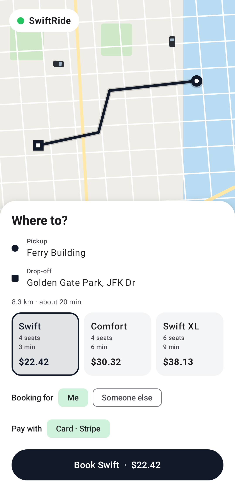 | 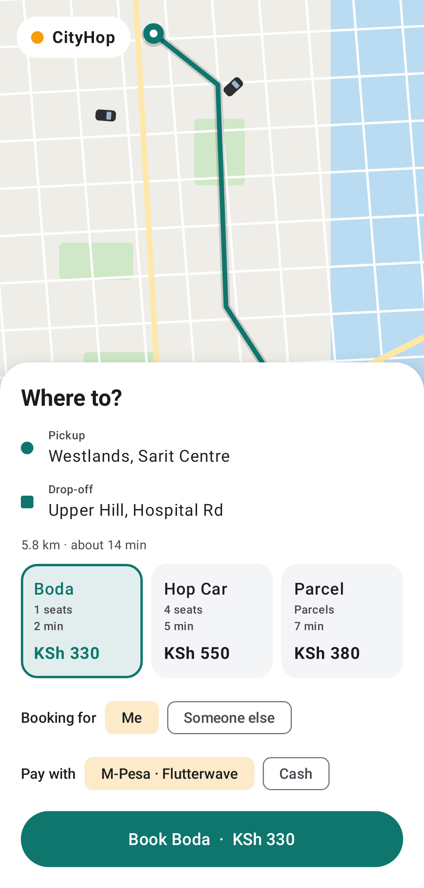 | 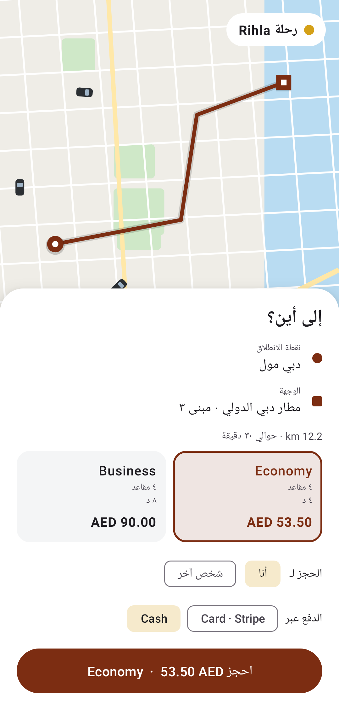 | 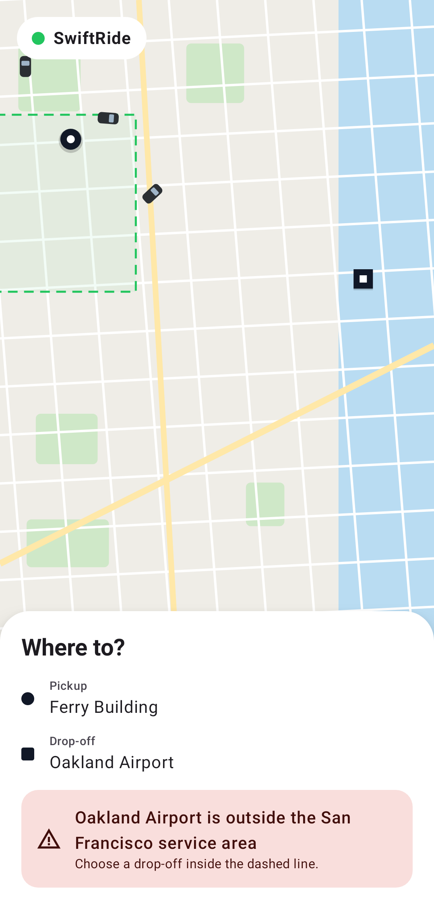 |

| Book for someone else (dark) | Driver on the way | End-of-ride fare | Fare in Arabic |
|---|---|---|---|
| 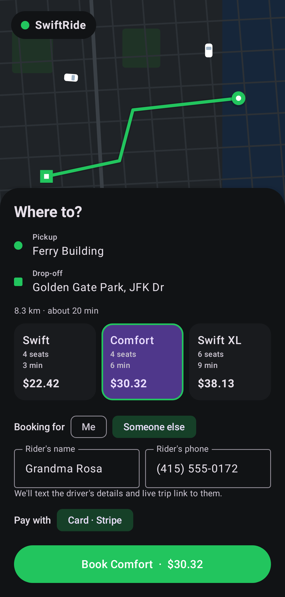 | 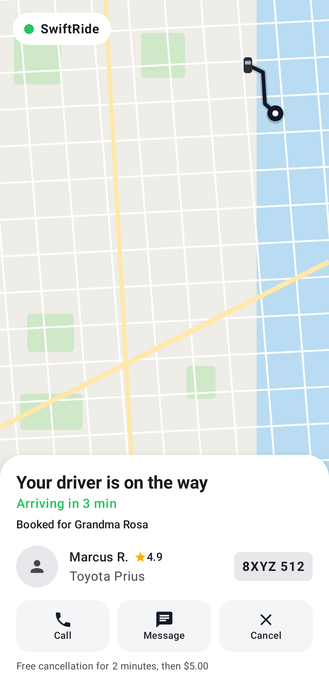 | 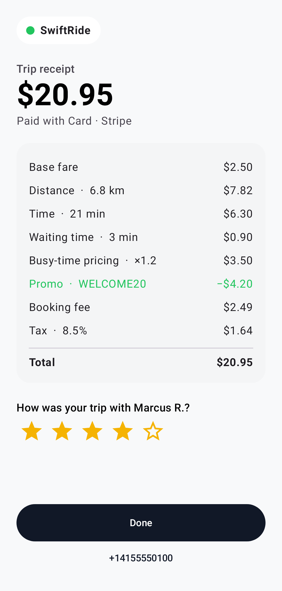 | 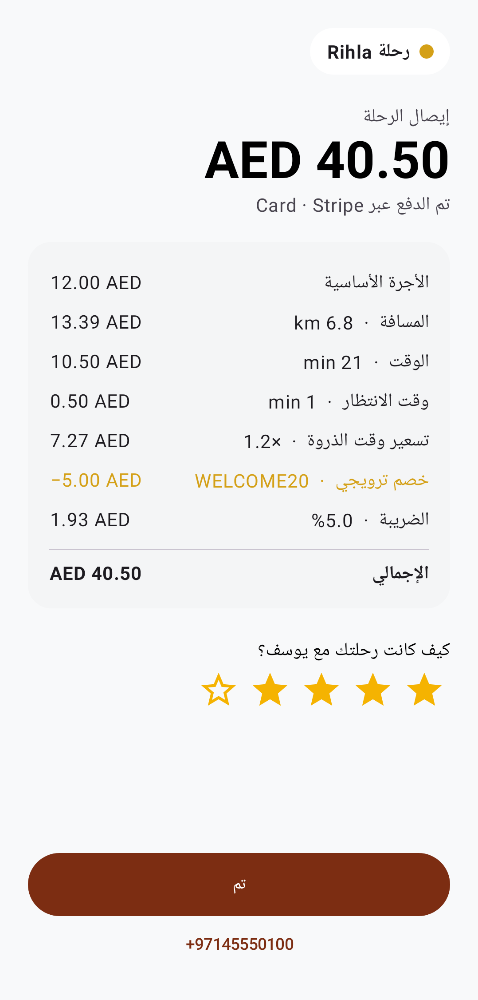 |

| Driver: trip request | Driver: delivery (dark) | Proof of delivery signature | Kiosk |
|---|---|---|---|
| 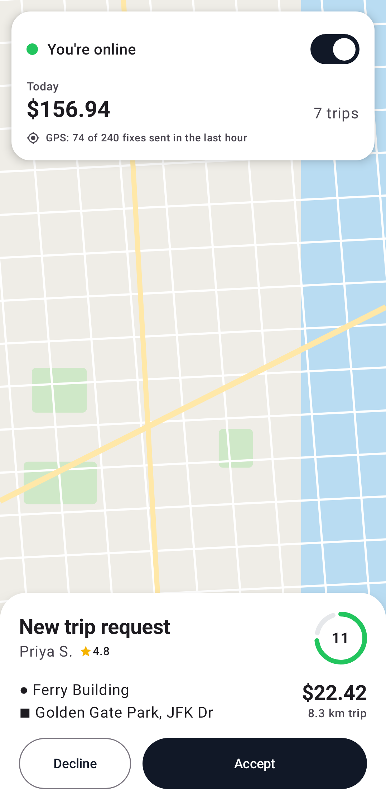 | 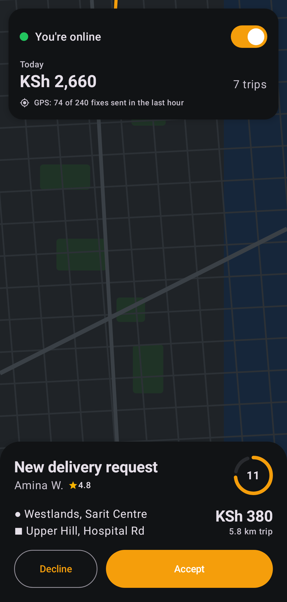 | 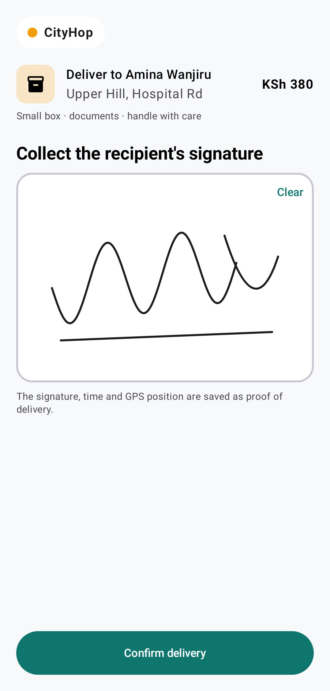 | 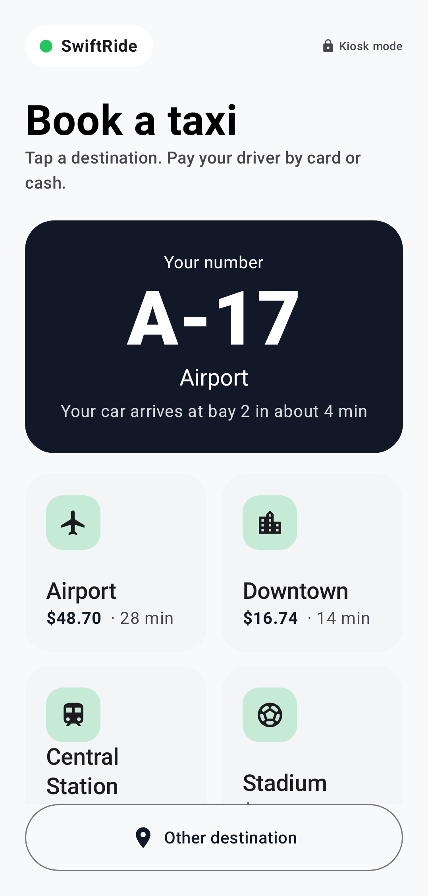 |

## How the white-labelling works

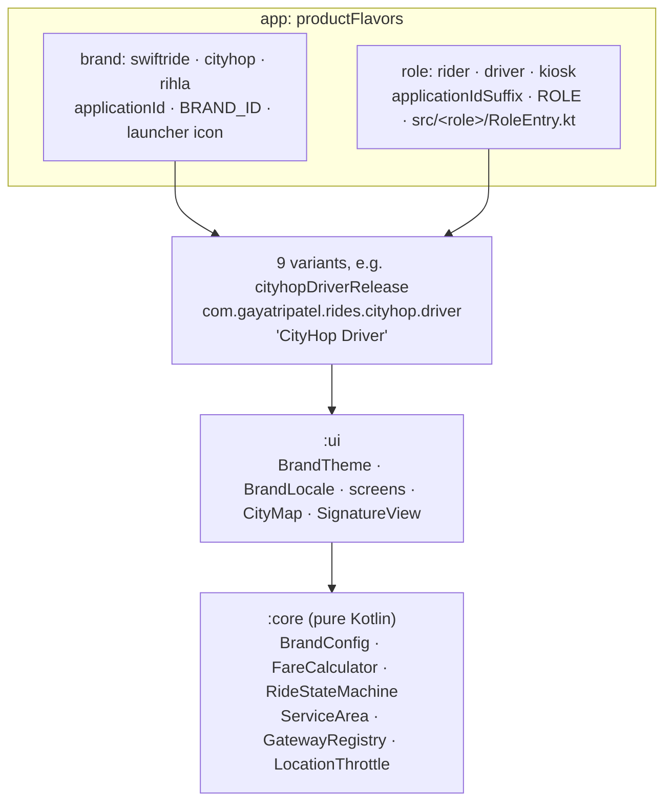

- **Brand flavor**: application id, `BuildConfig.BRAND_ID`, launcher icon (`src/<brand>/res`). The launcher name per variant (`SwiftRide`, `SwiftRide Driver`…) is set with the `androidComponents` variant API.
- **Role flavor**: application id suffix and a role-specific source set. `src/rider`, `src/driver` and `src/kiosk` each provide `RoleEntry`, so a rider APK contains no driver or kiosk code. `src/kiosk/AndroidManifest.xml` adds Lock Task Mode to the kiosk build only.
- **Everything else is config**: `BrandConfig` (colours, currency and rounding, language, service area, vehicle types with fare rules, enabled payment gateways, cash limits). A new client is a new config entry and flavor, not a fork.

## Highlights

| Area | What's in the code |
|---|---|
| **Fares** | `FareCalculator`: base, distance, time, waiting after a free period, surge, minimum-fare adjustment, promo with cap, booking fee, tolls and tax, with per-currency rounding (KES to 10 shillings, AED to 50 fils). The same calculator produces the estimate and the **end-of-ride fare** from the GPS trace (`Geo.traceLengthMeters` drops GPS spikes), so the receipt explains every difference. |
| **Booking** | Service-area check (`ServiceArea` point-in-polygon) before booking, **book for someone else** (name and phone get the trip link), vehicle choice with live fare. |
| **Ride lifecycle** | `RideStateMachine`: free cancellation within a grace period, a fee after it or after the driver arrives, waiting time measured from arrival. |
| **Driver app** | `LocationThrottle` cuts location traffic between trips (cheaper, less frequent fixes, and only send when moved or on heartbeat). The driver screen shows fixes vs. sends live. `TripOfferGuard` drops stale and duplicate offers that caused **ghost trips**. |
| **Payments** | 6 gateways behind one `PaymentGateway` interface (Stripe, Razorpay, Flutterwave M-Pesa, Xendit, Omise, cash). `GatewayRegistry` offers only what the admin panel enabled **and** the currency supports, with a cash cap. |
| **Parcel delivery** | `SignatureView`, a custom-drawn `View` with Bézier-smoothed strokes, exported as PNG for proof of delivery. |
| **Kiosk** | Self-service booking with big touch targets and ticket numbers, pinned with Lock Task Mode. |
| **i18n / RTL** | English + Arabic resources; `BrandLocale` starts each brand in its own language and direction regardless of device locale. |

## Build

```bash
./gradlew :core:test                    # 13 JVM tests: fares, geo, ride states, throttling, payments
./gradlew :ui:recordRoborazziDebug      # renders the screenshots above
./gradlew assembleDebug                 # all 9 apps
./gradlew assembleCityhopDriverDebug    # just one
```

JDK 17. The map is drawn on a Canvas so the demo needs no Maps API key; production builds use the Google Maps SDK.

## License

MIT
